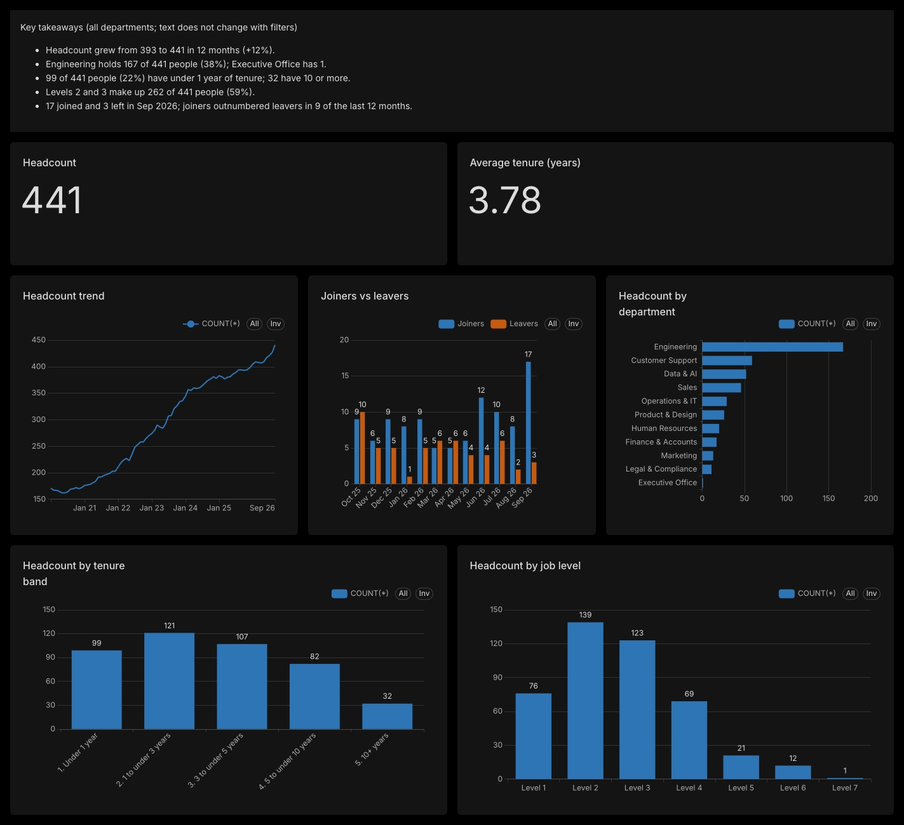
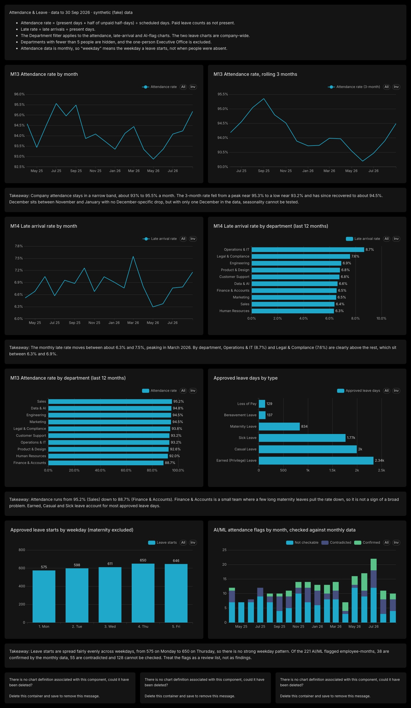

# PulseIQ – Phase I

Workforce analytics pipeline, warehouse and dashboards for the fictional company Zenith Nova Technologies
(all data is fictional and synthetic).

## Status
- [x] Task 1: ETL pipeline (extract, transform, validate, publish, run log, tests, metric dictionary)
- [x] Task 2: Analytics warehouse
- [x] Task 3: Headcount & Departments dashboard
- [x] Task 4: Attendance trends analysis and Attendance & Leave dashboard

## What it looks like

Two Superset dashboards read the warehouse's `reporting` views (aggregates only, no employee IDs). All data is fictional and synthetic.

**Headcount & Departments:** headcount and tenure, joiners vs leavers, department and level mix, with a Department filter.



**Attendance & Leave:** attendance and late-arrival trends by month and department, leave by type, leave starts by weekday, and the AI/ML anomaly flags checked against our monthly data. Each row has a one-line takeaway, and the header note states the limits.



## Quick start
Requirements: Docker Desktop (tested with Docker 29.8 and Compose v5).

1. Put `03_PulseIQ_Analytics_Star_Schema_Dataset.xlsx` in `data/raw/`. Data is **not** committed to Git.
2. `cp .env.example .env`
3. Run the pipeline (the required command):
   ```
   docker compose run etl
   ```
   (add `--rm` to remove the finished container, and `--build` after changing code).

With the supplied workbook the default strict policy **fails with exit code 1**, because 4 rows are invalid
(2 payroll rows for unknown employees, 2 leave requests ending before they start). To publish the valid rows
and still save the rejects, run:
```
docker compose run --rm -e ALLOW_REJECTS=true etl
```

Run the tests: `docker compose run --rm --build tests`

## What the pipeline does
1. **Extract** the four source sheets (`dim_employee`, `fact_payroll`, `fact_attendance_monthly`, `fact_leave`) and log rows in. Missing file/sheet/column stops the run.
2. **Transform**: trim text, convert dates and numbers, remove exact duplicates. No business value is changed or filled in.
3. **Validate** with pandera: valid dates, non-negative pay, correct keys per dataset, employee references. Bad rows are rejected with a reason.
4. **Enrich** valid rows with year, month and tenure columns (tenure measured to the fixed reporting date).
5. **Publish** clean Parquet files, rejected-row CSVs and a run-log line, using a safe staging-then-swap.

There is no separate "salary" file in the workbook: salary figures are columns of `fact_payroll`.

## Outputs
| Path | Content |
|---|---|
| `data/clean/*.parquet` | `employee`, `payroll`, `attendance`, `leave` (valid rows, sorted, no timestamps) |
| `data/rejected/*_rejected.csv` | Rejected rows with `dataset`, `source_row`, `reject_reason` (header only when none) |
| `logs/runs.jsonl` | One JSON line per run: start/end time, status, exit code, rows in/out/rejected/duplicates per dataset, input hash, output fingerprint |

`data/` and `logs/` are git-ignored because they hold employee and pay data.

## Exit codes and publication policy
| Code | Status | Meaning | `data/clean/` |
|---|---|---|---|
| 0 | `SUCCESS` | no rejected rows | replaced |
| 0 | `SUCCESS_WITH_REJECTS_OVERRIDE` | rejects exist and `ALLOW_REJECTS=true` | replaced |
| 1 | `FAILED_VALIDATION` | rejects exist, strict default | untouched |
| 2 | `FAILED_STRUCTURAL_OR_CONFIG` | missing file/sheet/column or bad setting | untouched |
| 3 | `FAILED_UNEXPECTED` | bug in the pipeline | untouched |

A failed run can never replace good output. Full rules and reasoning: [docs/cleaning_rules.md](docs/cleaning_rules.md).

## Configuration (`.env`, see `.env.example`)
| Variable | Meaning |
|---|---|
| `INPUT_WORKBOOK` | Path to the workbook (inside the container: `data/raw/...`) |
| `REPORTING_DATE` | Fixed date used for tenure and date checks (`2026-09-30`). Never "today" |
| `ALLOW_REJECTS` | `false` (default): any rejected row fails the run. `true`: publish valid rows, still save rejects |

## Repeatability
Clean files contain no timestamps and are sorted by key, so the same input gives byte-identical files (verified by comparing SHA-256 hashes across runs, and between Docker on an Apple-silicon Mac and a separate x86 Linux machine). Run timestamps in the log change on every run; the `output_fingerprint` does not.

## Folder structure (provisional: the assignment's Part 4 structure was not provided)
```
src/pulseiq/   config, errors, extract, transform, validate, enrich, publish, runlog, __main__
tests/         pytest suite (valid, invalid and repeated runs)
data/          raw/ (input, read-only in Docker), clean/, rejected/   (git-ignored)
logs/          runs.jsonl                                              (git-ignored)
docs/          metric-dictionary.md, cleaning_rules.md
sql/           warehouse SQL (Task 2)
dashboards/    exported dashboards (Tasks 3 and 4)
```

## Documentation
- [Metric dictionary](docs/metric-dictionary.md): Headcount, Payroll cost, Attendance rate, Leave without pay days, Average tenure
- [Cleaning, validation and publication rules](docs/cleaning_rules.md), including the joining-after-leaving decision

## Known limitations and open items
- Only the workbook was supplied; no separate Python-team export files exist.
- `fact_attendance_monthly` is monthly. The Task 2 brief describes attendance per day. Decision: the warehouse keeps the monthly grain (one row per employee version per month), as in the source.
- 82 payroll rows (85 attendance rows) fall after the valid_to of their employee version. Resolved in Task 2: they are the final months of leavers, and the as-of rule links them to the right version (check Q4 in sql/q4_facts_link_to_effective_version.sql).
- Reject files contain full row data (including pay). Keep them local.
- Dependencies are pinned in `requirements.txt` (pandas 3.0.6, pandera 0.34.1, pyarrow 26.0.0, openpyxl 3.1.5) on Python 3.13.
- Warehouse schema diagram: docs/schema_diagram.png (SQL in sql/01_schema.sql)

## How to run (Docker only; needs `.env`, copy from `.env.example`)

```
docker compose run --rm --build tests                              # 48 tests
docker compose run --rm --build -e ALLOW_REJECTS=true etl          # clean data -> data/clean (a strict run exits 1 if rows are rejected)
docker compose run --rm --build load                               # schema + upserts into PostgreSQL, builds the headcount fact
docker compose run --rm load python -m pulseiq.check_headcount     # vs workbook: 891 department-months match
docker compose run --rm load python -m pulseiq.check_answers       # 3 SQL answers + integrity check vs clean files
```

Loading twice changes nothing (0 inserted, 0 updated).

## Warehouse

- Schema: `sql/01_schema.sql`; diagram: `docs/schema_diagram.png`
- Design and grains: `docs/warehouse-schema.md`
- Keys, SCD2 and the department-transfer rule: `docs/scd2_keys_and_transfers.md`
- Headcount rules and validation: `docs/headcount_validation.md`
- Answers: `sql/q1..q4_*.sql`
- Dashboard style guide: docs/style_guide.md
- Dashboard design review and definitions: docs/design-notes.md

## Task 3: Headcount & Departments dashboard

- Style guide: docs/style_guide.md. Layout review: docs/design-notes.md.
- Superset runs in Docker Compose (`docker compose up -d superset`, then http://localhost:8088).
- The dashboard reads only the `reporting` views (sql/02_reporting_views.sql) through the read-only login `superset_ro` (sql/10_readonly_role.sql). It never sees names, dates of birth or payroll.
- Charts: Headcount, Average tenure, Headcount trend, Joiners vs leavers, Headcount by department, by tenure band and by job level, plus key takeaways. Filters: Department and Date range.
- Checks: `python -m pulseiq.check_reporting` (views vs pandas) and sql/q5_dashboard_numbers.sql (every dashboard number).
- Export: dashboards/headcount_departments/ (no password stored). See dashboards/README.md to restore it.

## Task 4: Attendance analysis

Definitions: [docs/attendance_definitions.md](docs/attendance_definitions.md). Findings: [reports/insights-attendance.md](reports/insights-attendance.md) (insight note with three findings, limits and the December answer).

Run each from the project folder (the `--build` flag makes Docker use the latest code):

| Command | What it does |
|---|---|
| `docker compose run --rm --build load python -m pulseiq.attendance` | Company monthly rates and checks A1 to A6 (`STATUS=ALL_MATCH`) |
| `docker compose run --rm --build load python -m pulseiq.attendance_report` | Department summary, rolling 3 months, December check |
| `docker compose run --rm --build load python -m pulseiq.leave_analysis` | Leave by status, type, start weekday and department |
| `docker compose run --rm --build load python -m pulseiq.anomaly_review` | Checks the AI/ML anomaly flags against our attendance facts |

Decisions:
- Attendance rate = (present days + 0.5 x half days unpaid) / scheduled days, pooled (sum over sum). Paid leave counts as not present. Groups under 5 employees are blank.
- 4 attendance rows dated after the employee left (DQ-01) are excluded; 1 employed month has no row and is not filled in.
- Only Approved leave counts as leave taken. Leave running past September 2026 is cut off and pro-rated.
- The anomaly flags are a review list only. They join on employee and month; 55 of 221 attendance flags are contradicted by our data. They feed no metric.
- Finance & Accounts has the lowest rate because of two long maternity leaves, not poor attendance.

### Task 4 dashboard and number checks

The **Attendance & Leave** dashboard (8 charts, a Department filter and a takeaway under each row) is exported to [dashboards/attendance_leave/](dashboards/attendance_leave/); see [dashboards/README.md](dashboards/README.md) to restore it. Superset reads only the `reporting` views in `sql/03_attendance_reporting.sql`, which hold aggregates and no employee IDs. The AI/ML flags are loaded into `fact_anomaly_attendance` (warehouse schema, employee IDs, not readable by `superset_ro`).

| Command | What it does |
|---|---|
| `docker compose run --rm --build load python -m pulseiq.check_attendance_reporting` | Compares every reporting view with the pandas calculations, checks B1 to B6 (`STATUS=ALL_MATCH`) |
| `docker compose exec -T db sh -c 'psql -U "$POSTGRES_USER" -d "$POSTGRES_DB"' < sql/q6_attendance_dashboard_numbers.sql` | Reproduces every figure shown on the dashboard from the views |

Decisions for the dashboard:
- The Executive Office (1 person) and any group under 5 employees are left out of every view.
- The weekday chart shows the weekday a leave starts, because the data is monthly and has no daily attendance.
- The leave charts are company-wide, so the Department filter does not apply to them.
- Loading `fact_anomaly_attendance` needs the workbook (`INPUT_WORKBOOK`); without it the loader warns and skips the flags.

## Handoff package

Everything other teams need is in this repository. Nothing is sent anywhere else.

| Item | Where |
|---|---|
| Metric dictionary (M01 to M15 so far) | [docs/metric-dictionary.md](docs/metric-dictionary.md) |
| Warehouse schema, grain of each fact, keys | [docs/warehouse-schema.md](docs/warehouse-schema.md), diagram in [docs/schema_diagram.png](docs/schema_diagram.png) |
| Dashboard exports (import into Superset) | [dashboards/headcount.zip](dashboards/headcount.zip), [dashboards/attendance.zip](dashboards/attendance.zip); the same files unzipped are in `dashboards/headcount_departments/` and `dashboards/attendance_leave/` |
| Attendance insight note | [reports/insights-attendance.md](reports/insights-attendance.md) |
| Dashboard design notes | [docs/design-notes.md](docs/design-notes.md) |
| Phase 1 review | [reports/phase-1-review.md](reports/phase-1-review.md) |

## Assumptions

- Work was committed straight to `main` in Phase 1, so there are no pull-request links. Later phases will use pull requests from branches.
- The warehouse database is `pulseiq` (tables in the default schema, dashboard views in the `reporting` schema), not `pulseiq_wh` with schema `dw`. Table names follow our own design, for example `fact_attendance` where the reference sheet says `fact_attendance_monthly`.
- The fixed "today" for tenure and ageing is set with `REPORTING_DATE=2026-09-30`, which does the job of `DEMO_TODAY`.
- Superset's admin password and secret key come from `.env`, not from the guide's local defaults.
- Dashboard colours are Superset's defaults, with vermillion for leavers. The guide's navy, blue and orange palette is not applied yet.
- The weekday view shows the weekday a leave starts, because attendance data is monthly and has no daily rows.
- AI/ML anomaly flags are shown as a review list only, with each flag checked against our monthly data. They feed no metric.
